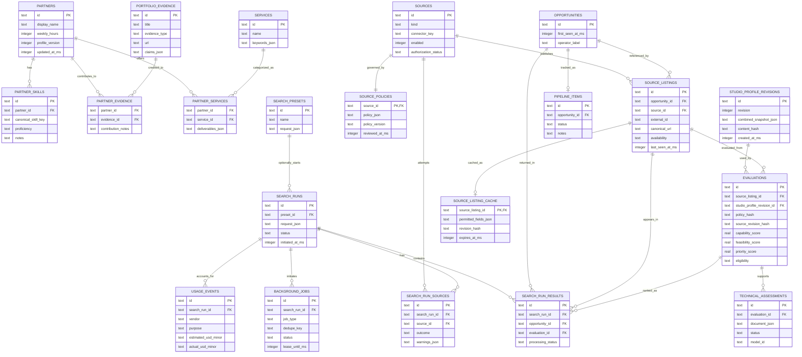
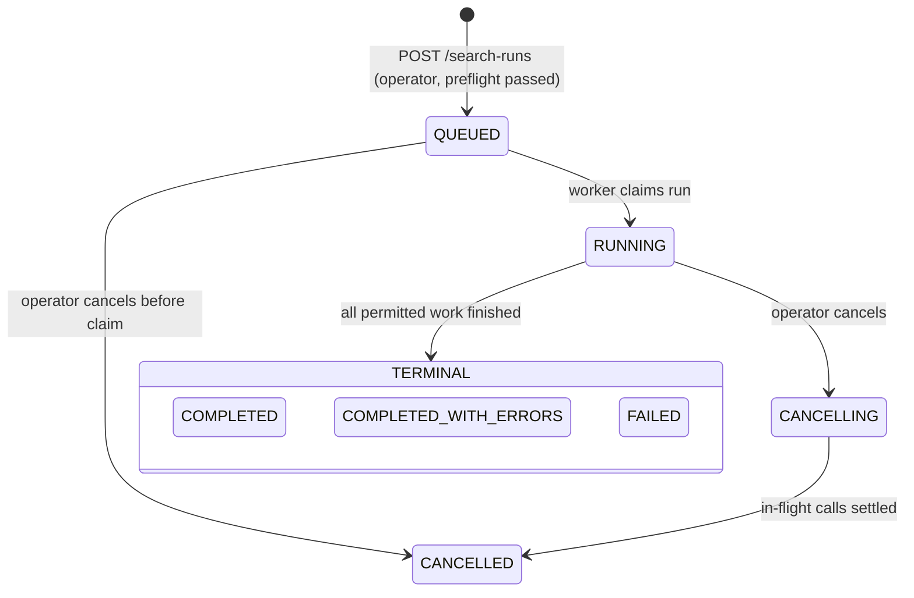

# Freelance Opportunity Intelligence (FOI)
## Version-Controlled Architecture and Implementation Specification

**Spec version:** `1.1.1` (frozen; 1.1.1 is an editorial patch)  
**Issued:** 20 October 2026 (v1.0.0); frozen as v1.1.0 on 20 October 2026  
**Upstream product baseline:** [`FOI_DESIGN_BASELINE.md`](./FOI_DESIGN_BASELINE.md)  
**Authoritative scope:** Single-operator, two partner profiles, combined-studio scoring, manual searches, local-first, no submission automation.  
**Implementation status:** Phase 1 is being implemented against this version; the repository's `docs/PROGRESS.md` records what exists. Nothing in this file asserts that a module, endpoint, migration, connector or test exists.

> **Precedence in v1.1.0:** §16 (v1.1.0 amendments) is normative and wins over any earlier section it conflicts with. §16 adopts the findings of [`FOI_SPEC_REVIEW_2026-10-20.md`](./FOI_SPEC_REVIEW_2026-10-20.md) and the owner decisions D-020 to D-028 recorded in the baseline. Sections that the amendments changed most are also corrected in place and marked *(v1.1.0)*.

> **Implementer rule:** This file is a contract for the future implementation, not a report of completed work. Code samples are proposed public interfaces/pseudocode; validate them against the chosen TypeScript runtime/library versions. Do not add scheduling, scraping, submission, multi-tenancy, or existing-JSI database coupling. Treat all platform-specific integration details and source-field rights as unavailable until verified with the account and current vendor documentation. *(v1.1.0)* Never change a test's expected value to make it pass; report the conflict. Ask before adding any dependency not in `docs/DEPENDENCIES.md`. Write an ADR before deviating from this spec. Run the full suite before declaring a phase gate met, and label anything verified only against fixtures. Never put real credentials, listings or partner data into prompts, fixtures or commits.

## 0. Normative language and traceability

- **MUST / MUST NOT:** implementation requirement necessary to satisfy the confirmed user choices and stated data/security guarantees.
- **SHOULD:** recommended architectural control, subject to documented ADR if changed.
- **MAY:** optional implementation.
- **PROPOSED:** adjustable starting value, **not** an explicitly confirmed precise setting.
- **EXTERNAL:** gated by provider access, terms, and sample payload verification.

Canonical decision IDs are in the product baseline (`D-001` through `D-029`, `P-001` through `P-012`). The following are additionally **implementation** decisions, not new user-confirmed features:

| ADR | Decision | Rationale |
|---|---|---|
| ADR-001 | Modular monolith | Lowest operational overhead within local/low-budget constraints. |
| ADR-002 | Native Node.js/TypeScript API and worker, React web UI, SQLite/Drizzle | Reuse compatible reviewed JSI patterns; no cloud runtime dependencies. |
| ADR-003 | Postgres migration path via repositories rather than direct SQL calls from domain code | Future AWS deployment without replacing the domain. |
| ADR-004 | Source-policy enforcement before fetch, persistence, or LLM disclosure | Provider-specific contractual limits. |
| ADR-005 | Immutable studio-profile revisions and version-pinned evaluations | Prevent stale and cross-profile contamination. |
| ADR-006 | Currency values encoded as **integer minor units represented by decimal strings** + ISO 4217 currency | Avoid floating-point money errors and JSON BigInt problems. |
| ADR-007 | Timestamp wire format ISO 8601 UTC; SQLite storage as epoch milliseconds | Reliable timezone handling; display timezone is a client concern. |
| ADR-008 | External listings use explicit `null` / status for unknown fields, not optimistic defaults | Preserve uncertainty for decision support. |
| ADR-009 | Single active operator-triggered search per local instance in MVP | Simpler spend management and less source contention; independent in-flight workers inside a run permitted. |
| ADR-010 | Local HTTP API requires origin/host checks and authentication for mutation endpoints *(extended by ADR-011: all API routes)* | Loopback-only is not a complete browser threat boundary. |
| ADR-011 *(v1.1.0)* | Loopback-only bind; exact `Host` and `Origin`; required `X-FOI-Request` header on mutations; Fetch Metadata check; session required on every API route except health, setup status and launch exchange | Every localhost port is the same site; SameSite cookies do not isolate FOI (review SEC-01, SEC-02, SEC-10). |
| ADR-012 *(v1.1.0)* | One-time launch-token login; opaque random session IDs stored hashed server-side; no password and no session secret | Nothing to brute-force or leak; sign-out-all is a row delete (SEC-03). |
| ADR-013 *(v1.1.0)* | `SecretStore` backed by the macOS Keychain; OAuth authorization-code flow with session-bound `state`, PKCE where supported, single-flight refresh, stored granted scopes | Rotating tokens need a safe home outside the repo and database (SEC-04). |
| ADR-014 *(v1.1.0)* | Model output rendered as inert text; links only to evidence-index URLs; listing claims verified against quoted spans | Rendering is an exfiltration channel; score manipulation is the realistic injection (SEC-05, SEC-06). |
| ADR-015 *(v1.1.0)* | Split `factorPolicyVersion` (needs LLM) from `aggregationPolicy` (pure arithmetic) | Weight and threshold edits must not trigger paid re-evaluation (COST-01). |
| ADR-016 *(v1.1.0)* | `contentHash` excludes volatile signals; studio staleness uses a material profile hash and changed-skill intersection | Re-searches and typo fixes must not stale scores (COST-02, COST-03). |
| ADR-017 *(v1.1.0)* | Per-run cap on LLM quick evaluations with deterministic pre-ranking; prompt caching; cross-run evaluation reuse; pre-run cost estimate | Protect the $20 LLM allocation (COST-04, COST-05). |
| ADR-018 *(v1.1.0)* | Score bands; conservative default sort with a labelled `missingFactorPrior`; coverage gate for auto-assessment | Unknown must not outrank known-weak (SCORE-01, SCORE-02). |
| ADR-019 *(v1.1.0)* | Run status QUEUED, RUNNING, CANCELLING, then one terminal state from a pure, truth-table-tested function; progress as per-stage counters | Cancellation in paid stages; correct terminal states (SPEC-02). |
| ADR-020 *(v1.1.0)* | All data under `<repo>/data/`; `data/shared/` text export committed; database, cache, backups and logs ignored by Git; encrypted snapshots for full copies | Self-contained, shareable through a private repo without breaching retention rules (SEC-11, D-025). |
| ADR-021 *(v1.1.0)* | Worker runs inside the API process for the MVP, behind the same module boundary | One start command, one SQLite writer, simpler recovery (UX-01). |
| ADR-023 *(v1.1.1)* | Evidence is a studio-level resource at `/evidence` with one or two partner credits (`docs/adr/ADR-023-evidence-resource.md`) | Joint proof counts once without an owning partner (P2-03). |
| ADR-024 *(v1.1.1)* | `data/shared` files are the shared copy; outside changes are detected, loaded on request or at startup, never overwritten (`docs/adr/ADR-024-shared-sync.md`) | Protects teammates' work under D-025. |
| ADR-022 *(v1.1.0)* | Dependency allowlist; committed lockfile; `npm ci`; `ignore-scripts=true` with an explicit native rebuild; exact pins | Supply-chain risk on a machine holding credentials (SEC-13). |

---

# 1. Bounded contexts and module dependency rules

```text
web (React) -> api (Hono) -> application services
                                    |
         +--------------------------+---------------------------+
         |                          |                           |
   search orchestration       profiles/scoring             workflow
         |                          |                           |
   connectors / policy        LLM client / assessment      shortlist
         |                          |                           |
         +--------------------------+---------------------------+
                                    |
                          repositories (Drizzle)
                                    |
                                SQLite DB

worker consumes commands created by API/application services;
workers do not handle HTTP requests and UI cannot access DB directly.
```

**Boundaries:**

1. `domain/`: framework-free entities, enums, scoring policy arithmetic, decision reasons, validation models. Does not import HTTP or database implementation.
2. `connectors/`: sources conform to a provider-neutral `SourceConnector`; may depend on restricted `HttpClient`, credential provider, policy, and tracing; must not write directly to DB.
3. `application/`: orchestration, idempotency, eligibility, dedup, evaluation validity, cost preflight, data-retention gate; depends on repository interfaces.
4. `infra/`: SQLite/Drizzle adapters, external HTTP, LLM clients, secrets, usage pricing, structured logs, local file paths.
5. `api/`: HTTP request validation, session/auth, error mapping, pagination, projection, request idempotency.
6. `worker/`: persisted commands, leases, retries, cancellation, crash recovery; no scheduled discovery.
7. `web/`: state/data fetching, opportunity feed, comparison and assessment display, accessible profile editors.

Do not let connector-specific payload types leak into the API/UI or scoring domain. Convert them at the connector boundary.

## 1.1 Repository layout *(v1.1.0)*

```text
foi/
  README.md
  config.json             committed: non-secret startup settings
  package.json            npm workspaces root
  package-lock.json       committed; install with npm ci
  .npmrc                  ignore-scripts=true, save-exact=true
  tsconfig.base.json
  eslint.config.js
  docs/
    FOI_DESIGN_BASELINE.md
    FOI_ARCHITECTURE_SPECIFICATION.md
    FOI_SPEC_REVIEW_2026-10-20.md
    DEPENDENCIES.md       dependency allowlist (ADR-022)
    SECURITY.md           threat model (PROC-05)
    PROGRESS.md           what is implemented, phase by phase
    adr/
  scripts/                repository tooling (pre-commit check, hook installer, native rebuild)
  packages/
    domain/               framework-free contracts, money, defaults, pure policy functions
    infra/                SQLite/Drizzle schema and migrations, paths, logging, security helpers
    connectors/           source registry and adapters (adapters arrive in Phase 3)
  apps/
    server/               Hono API, application services, in-process worker (ADR-021), CLI entry points
    web/                  React + Vite single-page app
  data/                   ADR-020
    shared/               committed text export of team-owned data
    foi.sqlite            ignored by Git
    backups/              ignored by Git
    logs/                 ignored by Git
```

Tests live next to each workspace in `test/`. If the layout drifts, retain the module boundaries above.

## 1.2 Configuration *(v1.1.0)*

`config.json` at the repository root holds non-secret settings and is committed:

```json
{ "port": 4311, "logLevel": "info", "fixtureMode": true }
```

Environment overrides (for tests and one-off runs): `FOI_PORT`, `FOI_LOG_LEVEL`, `FOI_FIXTURE_MODE`, `FOI_DATA_DIR`.

- The server always binds to `127.0.0.1` (D-020). There is no bind-host setting; a `bindHost` key or `FOI_BIND_HOST` variable is ignored and logged.
- There is no session secret: sessions are opaque random IDs stored hashed (ADR-012).
- Provider credentials (LLM key, Brave key, marketplace OAuth tokens) live only in the macOS Keychain through `SecretStore` (ADR-013). They are never written to `config.json`, `.env`, the database, `data/shared/` or logs, and never served to the browser.
- Optional providers MUST remain disabled while their credentials or access policies are missing.

---

# 2. Database ERD and persistence contract

## 2.1 Entity-relationship diagram

The Mermaid diagram intentionally models **normalized, durable entities** and the **separate expiring source cache**. Cardinalities are illustrative relationships; exact cascade rules are below.



*Mermaid's ERD syntax omits some nullable FKs and unique constraints; the database rules below are authoritative. (v1.1.0) Where the ERD and §2.2 disagree on a column name, §2.2 wins; the ERD is regenerated from the Drizzle schema once it exists.*

## 2.2 Relational schema requirements

All primary keys are generated UUID strings unless explicitly noted. All time fields use UTC epoch milliseconds in SQLite and ISO timestamps on the API. Do not mix seconds and milliseconds. Migrations must be forward-only and indexed by version; perform backups before destructive schema changes.

| Table | Critical columns / constraints |
|---|---|
| `partners` | `id`, `display_name`, `weekly_hours` nullable, `profile_version > 0`, `updated_at_ms`; seed **two** partner slots in setup wizard; no public user account. |
| `partner_skills` | `id`, `partner_id FK`, `canonical_skill_key`, `proficiency`, `notes`, `updated_at_ms`; unique `(partner_id, canonical_skill_key)`. |
| `portfolio_evidence` | `id`, `title`, `evidence_type`, `source_url?`, `claims_json`, `verified_level`, `updated_at_ms`; reusable evidence item; do not duplicate fabricated claims. |
| `partner_evidence` | Unique `(partner_id FK, evidence_id FK)`, `contribution_notes`; one evidence item may legitimately credit both partners, each with editable attribution. |
| `services` | `id`, `name`, `search_taxonomy_json`, `enabled`; seed initial six service categories. |
| `partner_services` | `(partner_id FK, service_id FK)` unique, `deliverables_json`, explicit limitations. |
| `studio_profile_revisions` | `id`, monotonically increasing `revision`, canonical `combined_snapshot_json`, `content_hash`, `created_at_ms`; unique `revision`, immutable snapshots (content hashes can recur on reversion). |
| `sources` | `id`, `connector_key`, `kind`, `name`, `enabled`, `authorization_status`, `last_error?`, last validation time. |
| `source_policies` | `source_id PK/FK`, `policy_version`, `policy_json`, `reviewed_at_ms`, `review_reference`; edits should invalidate incompatible caches. |
| `search_presets` | `id`, `name`, `request_json`, `created_at_ms`, `updated_at_ms`; no next-run/schedule field. |
| `search_runs` | `id`, nullable `preset_id`, `request_json`, `status`, `studio_revision_id`, `policy_version`, `initiated_by='operator'`, timestamps, `summary_json`, `estimated_spend_usd_minor`. |
| `search_run_sources` | `id`, `search_run_id`, `source_id`, `status`, `outcome`, `fetched_count`, `pages_fetched`, `warnings_json`, `error_code?`, timestamps; unique `(search_run_id,source_id)`. |
| `opportunities` | `id`, `first_seen_at_ms`, `operator_label?`, created/updated timestamps. **Do not put unrestricted provider-owned listing text in this table.** |
| `source_listings` | `id`, `source_id`, `opportunity_id`, `external_id?`, `canonical_url?`, `availability`, `last_seen_at_ms`, `content_seen_revision?`; unique `(source_id,external_id)` when external ID exists, alternate URL identity carefully normalized. |
| `source_listing_cache` | `source_listing_id PK/FK`, `permitted_fields_json`, `revision_hash`, `observed_at_ms`, `expires_at_ms`, `retention_policy_version`; TTL purge; allow `TTL=0` to mean no persistence. |
| `search_run_results` | `id`, `search_run_id`, `opportunity_id`, nullable `source_listing_id`, nullable `evaluation_id`, `processing_status`, `seen_at_ms`, `error_code?`; unique `(search_run_id,source_listing_id)` when present. |
| `evaluations` | `id`, `source_listing_id`, `studio_profile_revision_id`, `source_revision_hash`, `scoring_policy_hash`, `prompt_version`, `model_id`, eligibility, scalar scores nullable, dimension scores/evidence/coverage/assumptions JSON, `evaluation_key UNIQUE`, timestamps, cost. |
| `technical_assessments` | `id`, `evaluation_id`, `status`, `document_json`, `model_id`, `prompt_version`, `error_code?`, cost/tokens, timestamps; unique assessment identity by evaluation+prompt version unless explicitly regenerated. |
| `pipeline_items` | `id`, `opportunity_id UNIQUE`, status, private notes, `next_action_at_ms?`, timestamps; not dependent on cached source text. |
| `background_jobs` | `id`, nullable `search_run_id`, `job_type`, `payload_json`, `dedupe_key` unique **among active queued/running work** (implement partial uniqueness or transactional check; completed work may be re-requested under a new explicit identity), attempts, status, lease owner/expiry, timestamps, last sanitized error. |
| `usage_events` | `id`, `search_run_id?`, `source_id?`, `vendor`, `purpose`, `request_identity`, `currency='USD'`, `estimated_usd_minor`, `actual_usd_minor?`, token/query units, timestamp, error/correction fields. |
| `app_settings` | `key PK`, `value_json`, `version`, `updated_at_ms`; scoring weights, thresholds, provider choices, per-run and monthly budgets. Secrets never go here. |

**Additional tables and columns *(v1.1.0)*:**

| Table / change | Critical columns / constraints | Phase |
|---|---|---|
| `sessions` | `id_hash` PK (SHA-256 of the random cookie value), `created_at_ms`, `last_seen_at_ms`, `expires_at_ms`, `user_agent?`; idle timeout PROPOSED 12 h | 1 |
| `audit_events` | `id`, `at_ms`, `action`, `subject_type?`, `subject_id?`, `details_json` (sanitized), `request_id?`; append-only, no update or delete path | 1 |
| `idempotency_keys` | `key` PK, `method`, `path`, `request_hash`, `status_code`, `response_json`, `created_at_ms`, `expires_at_ms`; same key + different hash → 409 | 1 |
| `background_jobs` | as §2.2 plus a partial unique index: `CREATE UNIQUE INDEX ux_jobs_active ON background_jobs(dedupe_key) WHERE status IN ('queued','running')`; `cancel_requested` flag; `lease_owner` | 1 |
| `skills` / `skill_aliases` | canonical `key`, `label`; alias → key, unique alias; seeds the taxonomy that `partner_skills.canonical_skill_key` references | 2 |
| `evaluation_feedback` | `id`, `evaluation_id`, `kind` (dismiss, shortlist, override, comment), `reason_code?`, `note?`, `at_ms` — never mutates the evaluation (invariant 6) | 4 |
| `source_connections` | `source_id` PK/FK, `granted_scopes_json`, `token_expires_at_ms?`, `last_refreshed_at_ms?`, `status`; tokens themselves only in `SecretStore` | 3 |
| `operator_blocks` | `id`, `kind` (client, keyword, source_listing), `value`, `reason?`, `created_at_ms` | 4 |
| `source_policies` | adds attestation fields: `attested_reference`, `attested_at_ms`, `review_expires_at_ms`, `permitted_fields_json`, `cache_ttl_seconds`, `llm_sharing_allowed` (SEC-14) | 3 |
| `search_runs` | `studio_profile_revision_id`, `aggregation_policy_hash`, `factor_policy_version`; per-stage counters in `progress_json`; `policy_version` is removed in favour of `search_run_sources.source_policy_version` | 3 |
| `source_listings` / cache | `content_hash` = SHA-256 of RFC 8785 canonical JSON of title, description, skills, budget, engagement, deadline, location restrictions; volatile signals in `listing_observations(source_listing_id, observed_at_ms, signals_json)` (ADR-016) | 3 |
| `evaluations` | replace `scoring_policy_hash` with `factor_policy_version` + `aggregation_policy_hash`; add `content_hash`, `studio_material_hash`, score bands (`*_lower`, `*_upper`), `rejected_factors_json` | 4 |
| `opportunities` | add `operator_label?` requirement on shortlist when the title is not persistable (UX-09) | 4 |
| all rows exported to `data/shared/` | stable IDs, no provider text, `is_fixture` rows excluded | 2+ |

**Foreign keys:** use `RESTRICT` for referenced profiles, evaluations, and audit entries that must retain provenance. Use `CASCADE` only for explicitly ephemeral source-cache rows and safe junctions. Avoid silently deleting saved shortlists or evaluations when a source is disabled. A purged provider cache should not break operator notes, but derived content retained in an assessment must be verified as permitted by provider policy.

### 2.3 Database invariants

1. Each evaluation references **exactly one** immutable studio-profile revision and one source-listing revision hash.
2. Every displayed current evaluation must match the **current** studio revision, current scoring-policy hash, and corresponding listing revision; otherwise return `stale: true` and block automatic reuse as current.
3. `status=COMPLETE` for a source run is valid only after the connector exhausted the requested bounded search with all planned pages successfully handled. A cap that truncates pagination is `PARTIAL` with a reason.
4. `PARTIAL`, `FAILED`, `RATE_LIMITED`, or `BLOCKED` outcomes MUST NOT age out other listings as closed or imply listing liveness.
5. Platform-owned descriptions and snapshots MUST NOT be persisted beyond a verified retention policy. Expired cache cannot be displayed as a current source fact.
6. Any manual override of an autogenerated score is stored as separate operator commentary/decision, not by mutating historical evaluation evidence.
7. Two source listings are not merged solely by similar title; a cross-source dedup is reviewable and conservative.
8. A search run's budget charge events and results remain queryable after source cache expiry (only to the extent provider rules allow derived records).

### 2.4 Suggested indexes

```sql
CREATE INDEX idx_listings_source_seen ON source_listings(source_id, last_seen_at_ms DESC);
CREATE INDEX idx_cache_expiry ON source_listing_cache(expires_at_ms);
CREATE INDEX idx_search_runs_started ON search_runs(initiated_at_ms DESC);
CREATE INDEX idx_run_results_lookup ON search_run_results(search_run_id, processing_status);
CREATE INDEX idx_evaluations_listing_rev ON evaluations(source_listing_id, source_revision_hash, studio_profile_revision_id);
CREATE INDEX idx_evaluations_priority ON evaluations(priority_score DESC);
CREATE INDEX idx_jobs_status_lease ON background_jobs(status, lease_until_ms);
CREATE INDEX idx_usage_timestamp ON usage_events(created_at_ms);
CREATE INDEX idx_pipeline_status ON pipeline_items(status, updated_at_ms DESC);
```

Any index referencing a nullable score must sort `NULL` last in application query logic. Ensure SQLite foreign-key enforcement is enabled (`PRAGMA foreign_keys=ON`); use WAL for a single-host local database on a supported local filesystem, not network-mounted storage.

---

# 3. TypeScript source connector interfaces

Contracts below are **proposed implementation contracts**, not claims about actual Upwork/Freelancer response schemas. They deliberately exclude vendor-specific raw response shapes.

```ts
// packages/domain/src/contracts/source.ts
export type ISODateTime = string; // validated ISO 8601 UTC on the boundary
export type Id = string;
export type SourceKind = 'marketplace_api' | 'company_api' | 'web_search' | 'manual';
export type EngagementType = 'fixed' | 'hourly' | 'monthly_retainer' | 'unknown';
export type Availability = 'open' | 'closed' | 'awarded' | 'unknown';
export type SourceOutcome = 'COMPLETE' | 'PARTIAL' | 'FAILED' | 'BLOCKED' | 'RATE_LIMITED';
export type TriState = 'pass' | 'fail' | 'unknown';

export interface Money {
  currency: string;            // ISO 4217 code validated at runtime
  minorUnits: string;          // nonnegative integer as decimal string, e.g. "30000" USD = $300
}
export interface MoneyRange {
  min: Money | null;
  max: Money | null;
  basis: 'project' | 'hour' | 'month' | 'unknown';
}
export interface Provenance {
  sourceField: string;         // vendor field name or extraction locator
  observedAt: ISODateTime;
  evidenceKind: 'source_field' | 'source_text' | 'operator' | 'derived';
}
export interface ClientSignals {
  verifiedPayment: boolean | null;
  rating: number | null;      // do not assume scale across providers
  completedProjects: number | null;
}
export interface CompetitionSignals {
  proposalCount: number | null;
  proposalBand: string | null;
  activityAt: ISODateTime | null;
}
export interface ExternalListing {
  sourceId: Id;
  externalId: string | null;
  originalUrl: string;
  canonicalUrl: string;
  title: string;
  description: string | null;
  clientName: string | null;
  engagement: EngagementType;
  advertisedBudget: MoneyRange | null;
  skills: string[];
  postedAt: ISODateTime | null;
  deadlineAt: ISODateTime | null;
  expectedDuration: string | null;
  locationRestrictions: string[];
  availability: Availability;
  competition: CompetitionSignals;
  client: ClientSignals;
  provenance: Record<string, Provenance>;
  observedAt: ISODateTime;
}
export interface SearchRequest {
  keywords: string[];
  excludedKeywords: string[];
  serviceIds: Id[];
  selectedSourceIds: Id[];
  engagements: EngagementType[];
  minAdvertisedBudgets: Partial<Record<'fixed' | 'hourly' | 'monthly_retainer', Money>>;
  targetMarkets: string[];   // preference; not a global hard block
  postedSince: ISODateTime | null;
  maxPagesPerSource: number;
  maxResultsPerSource: number;
}

export interface SourceAccessPolicy {
  sourceId: Id;
  version: string;
  reviewedAt: ISODateTime;
  reviewedReference: string;
  authorizationStatus: 'approved' | 'pending' | 'denied' | 'unknown';
  allowedMethod: 'official_api' | 'licensed_search_api' | 'permitted_feed' | 'manual';
  requireAttribution: boolean;
  canCacheRaw: boolean;
  rawCacheTtlSeconds: number;   // 0 = do not persist raw normalized content
  persistableFields: string[]; // explicit allowlist; default empty
  canPersistDerivedScores: boolean;
  canShareWithExternalLLM: boolean;
}
export interface SourcePage {
  listings: ExternalListing[];
  nextCursor: string | null;
  pageOutcome: SourceOutcome;
  warnings: string[];
  retryAfterMs?: number;
}
export interface ConnectorContext {
  sourceId: Id;
  signal: AbortSignal;
  http: RestrictedHttpClient;           // guarded network path
  credentials: ConnectorCredentials;   // server-side only
  policy: SourceAccessPolicy;
  reportUsage(event: UsageReport): void;
}
export interface SourceConnector {
  readonly key: string;
  readonly kind: SourceKind;
  validateConfiguration(config: unknown): void;
  // Must never silently claim approved authorization.
  validateAccess(context: ConnectorContext): Promise<void>;
  // Page results may be streamed for progress and partial preservation.
  search(context: ConnectorContext, request: SearchRequest): AsyncIterable<SourcePage>;
}
export interface RestrictedHttpClient {
  request(options: {
    url: string;
    method?: 'GET' | 'POST';
    headers?: Record<string, string>;
    body?: string;
    timeoutMs: number;
    maxResponseBytes: number;
  }): Promise<{ status: number; body: string; headers: Record<string, string> }>;
}
export interface ConnectorCredentials {
  get(key: string): Promise<string | null>;
}
export interface UsageReport {
  provider: string;
  purpose: 'search' | 'quick_eval' | 'technical_assessment';
  estimatedUsdMinor: string;
  actualUsdMinor?: string;
  units: number;
}
```

### 3.1 Connector execution contract

- **Before dispatch:** `authorizationStatus='approved'`, valid approved retrieval method, nonexpired policy review if required, required credentials available, and cost/budget preflight pass. `unknown` authorization MUST fail closed.
- **Data validation:** Schema-validate every page and listing; reject/diagnose malformed rows without losing correctly parsed siblings. Enforce response size, max titles/descriptions, URL validity, normalized dates, and monetary scales.
- **Completeness:** A fetch only returns `COMPLETE` if the requested pagination was genuinely exhausted and not merely capped. A `SourcePage` with `pageOutcome=COMPLETE` MUST have `nextCursor=null`; otherwise the adapter must continue or mark `PARTIAL`. A blocked or failed page after successful pages yields a `PARTIAL` source-run result, not `COMPLETE`.
- **Rate limits:** Honor `Retry-After` / vendor quotas; retries use bounded exponential backoff with jitter. Do not bypass platform access controls.
- **Identity:** Use `sourceId + externalId` if available; otherwise safely normalized URL with source provenance. Do not dedupe across sources without a strong corroborating identifier.
- **Retention:** Normalize in memory; only persist allowlisted fields for the permitted TTL. Do not send fields to an LLM unless `canShareWithExternalLLM` is verified true.
- **Attribution:** Preserve source name/link and any required branding in results as supported by the provider terms.
- **Security:** No direct `fetch` outside the restricted outbound HTTP implementation. Do not store passwords or embed credentials in browser code.

### 3.2 Source status model

| Status | Meaning | Closure/aging impact |
|---|---|---|
| `COMPLETE` | All requested bounded pages obtained and validated | Can update source-observation freshness; **not** sufficient by itself to declare individual projects closed unless the provider documents complete enumeration semantics. |
| `PARTIAL` | Some useful records, but pages/keywords missing or requested result cap reached | Preserve records; no negative liveness inference. |
| `FAILED` | Request failed; useful records not returned | Preserve prior listings; display error. |
| `BLOCKED` | Authorization, terms, or security gate prevented retrieval | No outbound request where blocked preflight; preserve prior listings. |
| `RATE_LIMITED` | Provider quota exhausted or 429 response | Preserve prior listings; retry only inside permitted current operator-initiated work and policy. |

### 3.3 Provider implementations (EXTERNAL)

- `FreelancerConnector`: requires documented OAuth scopes, correct current REST query shape, and retention policy. The official Python SDK is reference material, not a requirement to run Python.
- `UpworkConnector`: requires approved API credentials and `Read marketplace Job Postings` permission; use documented GraphQL operations, not scraped authenticated HTML.
- `WebSearchConnector`: uses an authorized search API to find leads and canonical company pages; search hits are `availability='unknown'` until the opportunity page is lawfully verified. A search snippet is not a full verified project.
- `CompanyBoardConnector`: optional selected ATS/contract board adapters, validated for actual independent contract listings. Do not import all JSI employer ATS connectors.
- `ManualConnector`: operator-supplied URL/text; any auto-fetch still follows outbound security/rights rules.

### 3.4 External verification register

| Source | Validation prerequisite | Known reference |
|---|---|---|
| Upwork | API application/key approval and job-postings read permission; validate fields and usage rules with account | https://www.upwork.com/developer/documentation/graphql/api/docs/index.html |
| Freelancer.com | OAuth credentials, permitted API usage, permitted caching, actual availability of bid/compensation fields | https://github.com/freelancer/freelancer-sdk-python |
| Brave Search API | Subscription/free credit conditions and API key; check current billing | https://api-dashboard.search.brave.com/documentation/pricing |
| Any additional platform | Explicit right to automate discovery, retain fields, and use external LLM processing | Provider-specific agreement/docs to be added as ADR |

---

# 4. Manual search state machine and worker protocol

## 4.1 Search-run status model *(v1.1.0, ADR-019)*



- Fetching, normalization, screening, scoring and assessment overlap freely. Progress is reported as per-stage counters in `search_runs.progress_json`: `fetched`, `normalized`, `screened`, `scored`, `assessed`, `skipped` (with reason counts).
- Cancellation is possible at any point before a terminal state, including while evaluating or assessing. `CANCELLING` stops new paid calls immediately; results already obtained are kept under source rights.
- The terminal state is computed by one pure function, `deriveTerminalStatus(sourceOutcomes, itemOutcomes, cancelled)`, tested against a truth table:
    - `CANCELLED` if the operator cancelled.
    - `FAILED` if no source produced usable records, or a non-recoverable storage error occurred.
    - `COMPLETED_WITH_ERRORS` if any source ended `PARTIAL`, `FAILED`, `BLOCKED` or `RATE_LIMITED`, or any item ended `EVALUATION_FAILED`, `SKIPPED_BUDGET` or assessment `FAILED`.
    - `COMPLETED` otherwise.
- Selected sources that are blocked at preflight are rejected with `422` and reasons; no run is created (UX-05).

**Manual-only guarantee:** Creating a run requires an operator API request. Worker retries after crashes are continuation of the same initiated run; they are not new discovery schedules. Saved presets have no recurrence field. No cron for search/refresh.

## 4.2 Distinct subordinate state machines

Source attempt: `QUEUED -> RUNNING -> {COMPLETE, PARTIAL, FAILED, BLOCKED, RATE_LIMITED}`.

Opportunity result: `RETRIEVED -> NORMALIZED -> {FILTERED, INELIGIBLE, NEEDS_INFO, READY_TO_SCORE} -> {SCORED, EVALUATION_FAILED} -> {ASSESSMENT_QUEUED, READY_FOR_REVIEW}`.

Assessment: `NOT_REQUESTED -> QUEUED -> RUNNING -> {SUCCEEDED, FAILED, CANCELLED, SKIPPED_POLICY, SKIPPED_BUDGET}`. An old successful assessment may be separately labelled `stale` when current profile/listing versions change; staleness is derived, not a destructive status mutation.

Pipeline (operator-maintained): `discovered`, `shortlisted`, `reviewed`, `proposal_drafted`, `proposal_submitted`, `responded`, `negotiating`, `won`, `lost`, `archived`. Transitions from proposal stages mean **recorded by operator**, not executed by FOI.

## 4.3 Job contracts, cancellation, idempotency

```ts
export type JobType =
  | 'source_search'
  | 'normalize_batch'
  | 'screen_batch'
  | 'quick_evaluate_batch'
  | 'generate_assessment';

export interface WorkerCommand {
  id: string;
  jobType: JobType;
  runId: string | null;
  dedupeKey: string;
  payload: unknown;          // validate discriminated payload by jobType
  attempts: number;
  leaseUntil: string | null;
  createdAt: string;
}
```

**Identity rule:** `dedupeKey` MUST incorporate the *complete* logical work identity, such as `assessment:<evaluationId>:<promptVersion>` or `quick:<runId>:<canonical-hash-of-sorted-listing-ids>:<studio-revision>:<policy-version>`. Never use merely the first ID of a batch. `source_search` includes run ID, source ID, normalized query hash, and pagination partition (if relevant).

- API accepts `Idempotency-Key` on `POST /search-runs` and generation actions; replay with identical request returns the same resource; same key + different payload returns `409`.
- Initial MVP allows one active search run at a time; another `POST /search-runs` returns `409 SEARCH_ALREADY_RUNNING`. Evaluation/retries within one run may be concurrent under provider and budget limits.
- Persist queued commands before acknowledging work; worker claims atomically, uses a bounded lease, and renews while active. Recover crashed leases without duplicating completed side effects.
- Cancellation sets a flag and passes `AbortSignal`; it stops **future** requests/paid evaluations as soon as safely possible. Already completed results are retained under source rights.
- Retries are bounded, selectively applied to transient errors, and preserve event history. No automatic retries of denied authorization or policy blocks.
- No model-generated text is allowed to become a tool command or provider query without application-side validation.

## 4.4 Read-path behavior

`GET /search-runs/:id` and `GET /search-runs/:id/results` must return partial progress while the worker runs. The UI can poll at a reasonable interval (e.g. 2 seconds while active, lower frequency when idle). SSE is optional later; do not require a full WebSocket infrastructure.

---

# 5. Deterministic screening and scoring contracts

## 5.1 Opportunity eligibility

Run deterministic checks **before** billable model evaluation:

- `is_freelance_or_contract`: fail when explicitly full-time employment only; unknown when ambiguous.
- `geography_eligible`: fail only when verified restriction conflicts with operator-entered eligibility; never assume location/work authorization.
- `mandatory_requirement`: fail when a stated hard requirement is confirmed absent across both partner profiles; unknown when credentials cannot be confirmed.
- `commercial_floor`: test only comparable engagement unit and currency; **do not** silently convert non-USD amounts.
- `deadline_feasible`: fail only for demonstrable impossibility, considering partner-specific capacity and prerequisites; unknown with missing duration/scope.
- `listing_availability`: fail only when clearly closed/awarded; `unknown` is not `open`.
- `source_permitted`: block scoring or external LLM transfer if source policy disallows that operation.

**Budget comparison:** Threshold settings default to USD `$300/project`, `$20/hour`, `$500/month` (confirmed). Compare a source range to the floor using **advertised maximum** if available: if `maximum < floor`, then `fail`; if `min < floor <= max`, mark `possible`; if both min/max absent, `unknown`; if non-USD and no approved current FX reference, `unknown`. The `possible` state can be represented as `unknown` in the strict tri-state decision, accompanied by a reason that the upper range meets the floor. `possible` is **not** a verified firm price. Always keep an operator-visible diagnostic view for excluded opportunities.

```ts
export interface EligibilityDecision {
  status: 'eligible' | 'ineligible' | 'needs_information';
  checks: Array<{
    code: string;
    result: 'pass' | 'fail' | 'unknown';
    explanation: string;
    evidenceRefs: string[];
  }>;
  hardBlockers: string[];
}
```

Eligibility is logically separate from ranking. If any verified hard gate fails, the opportunity is `ineligible` even if a model believes it fits technically.

## 5.2 Scoring policy

**PROPOSED configurable policy v1.0:**

| Capability factor key | Weight |
|---|---:|
| `skills_coverage` | 0.40 |
| `portfolio_evidence` | 0.30 |
| `similar_delivery_experience` | 0.20 |
| `service_alignment` | 0.10 |

| Feasibility factor key | Weight |
|---|---:|
| `competition` | 0.30 |
| `economics` | 0.25 |
| `capacity_deadline` | 0.25 |
| `scope_clarity` | 0.15 |
| `client_credibility` | 0.05 |

Capability receives 60% of the combined priority; feasibility receives 40%. Each factor score is **0–100 when evidenced**, or `null` when not defensible from available facts. Missing bid count is not a proxy for low competition. A model cannot arbitrarily assign a neutral value to missing factors.

### Computation and coverage

Let factor weights within a dimension sum to 1. For observed factors, calculate:

\[
D = \frac{\sum_{i \in \mathrm{observed}} w_i s_i}{\sum_{i \in \mathrm{observed}} w_i}
\qquad
\mathrm{coverage}_D = \sum_{i \in \mathrm{observed}} w_i
\]

This normalization prevents treating missing factors as zero, **but** the result is provisional when coverage is incomplete; do not promote a high provisional value as high confidence.

**PROPOSED minimum evaluable coverage:** capability ≥0.60 and feasibility ≥0.50. Below these thresholds return `null` for that dimension and `priorityScore: null`, showing `needs_information`. If both dimensions are calculable, `priorityScore = round1(0.60*C + 0.40*F)`. If eligibility is `ineligible`, `priorityScore = null` or annotate it as non-actionable; never rank it as an actionable lead.

When the source denies external LLM sharing, attempt deterministic scoring from permitted structured fields only; otherwise return `needs_information`, never route the restricted text to an LLM.

**Competitor weighting:** Use only published/authorized bid/proposal counts or explicit bands. Calibrate per source; do not map unverified counts or universal thresholds into fabricated win probabilities. Competition is an attractiveness measure, not a predicted hiring probability.

**Delivery economics:** Use integer-minor-unit decimal amounts, conversion only with an independently supplied, timestamped FX rate, and hour estimates as bounded ranges with assumptions. A project may be economically attractive but need manual scope clarification. The gross thresholds are separate from estimated net effective hourly remuneration.

## 5.3 Evaluation types and scoring contract

```ts
export type EvaluationConfidence = 'low' | 'medium' | 'high';
export type EvaluationStatus = 'pending' | 'complete' | 'needs_information' | 'failed';
export type FactorKey =
  | 'skills_coverage'
  | 'portfolio_evidence'
  | 'similar_delivery_experience'
  | 'service_alignment'
  | 'competition'
  | 'economics'
  | 'capacity_deadline'
  | 'scope_clarity'
  | 'client_credibility';

export interface EvidenceReference {
  id: string; // server-generated ID linking an authorized source field or partner evidence
  origin: 'listing' | 'partner_profile' | 'portfolio' | 'operator' | 'calculation';
  entityId: string;
  fieldPath: string;
  observedAt: string;
  // Short excerpts only if policy allows retaining/displaying source text.
  permittedExcerpt?: string;
}
export interface FactorAssessment {
  key: FactorKey;
  score: number | null;       // if non-null: in [0,100]
  explanation: string;
  evidenceRefs: string[];      // IDs must resolve to EvidenceReference records
  missingData: string[];
  basis: 'direct_fact' | 'derived_calculation' | 'model_inference' | 'unknown';
}
export interface DimensionAssessment {
  score: number | null;
  coverage: number;           // in [0,1]
  provisional: boolean;
  factors: FactorAssessment[];
}
export interface ScorePolicy {
  version: string;
  capabilityWeight: number;   // proposed 0.60
  feasibilityWeight: number;  // proposed 0.40
  capabilityFactors: Record<
    'skills_coverage' | 'portfolio_evidence' | 'similar_delivery_experience' | 'service_alignment', number
  >;
  feasibilityFactors: Record<
    'competition' | 'economics' | 'capacity_deadline' | 'scope_clarity' | 'client_credibility', number
  >;
  minCapabilityCoverage: number;
  minFeasibilityCoverage: number;
  autoAssessmentMinPriority: number;
  autoAssessmentMinCapability: number;
  autoAssessmentMinFeasibility: number;
  maxAutomaticAssessmentsPerRun: number;
}
export interface OpportunityEvaluation {
  id: string;
  opportunityId: string;
  sourceListingId: string;
  listingRevisionHash: string;
  studioProfileRevisionId: string;
  scoringPolicyVersion: string;
  scoringPolicyHash: string;
  promptVersion: string;
  modelId: string | null;
  eligibility: EligibilityDecision;
  capability: DimensionAssessment;
  feasibility: DimensionAssessment;
  priorityScore: number | null;
  confidence: EvaluationConfidence;
  status: EvaluationStatus;
  evidence: EvidenceReference[];
  createdAt: string;
  stale: boolean;             // derived when queried; not an immutable source property
}
```

**Validation:**

- Weights in each factor group must sum to 1 within a deterministic epsilon; capability/feasibility weights must sum to 1.
- Non-null factor scores must lie within 0–100. Coverage is derived from evidenced factors, not freely supplied by the LLM.
- Every `evidenceRefs` entry must exist in the authorized evidence set for this exact listing revision and studio revision.
- If a model returns an invalid service/profile key, unknown factual reference, or evidence from a different project, reject that result; **do not silently substitute** another partner or profile.
- `stale` is set by server read logic when stored versions diverge. A stale high score is not eligible for auto-assessment without reassessment.

### 5.4 Scoring procedure

```ts
function computeDimension(
  factorWeights: Record<string, number>,
  factors: Array<{ key: string; score: number | null; evidenceRefs: string[] }>,
  minCoverage: number,
): { score: number | null; coverage: number; provisional: boolean } {
  let weightObserved = 0;
  let weightedSum = 0;
  for (const [key, weight] of Object.entries(factorWeights)) {
    const f = factors.find((x) => x.key === key);
    if (!f || f.score === null || f.evidenceRefs.length === 0) continue;
    if (f.score < 0 || f.score > 100) throw new Error(`invalid score for ${key}`);
    weightedSum += weight * f.score;
    weightObserved += weight;
  }
  const coverage = Math.min(1, weightObserved);
  return {
    score: coverage >= minCoverage ? Math.round((weightedSum / weightObserved) * 10) / 10 : null,
    coverage,
    provisional: coverage < 1,
  };
}
```

This is an **illustrative deterministic aggregator**, not the full extraction/evaluation implementation. Factor evidence must be validated before passing into this function. Model-suggested numbers require explanation, policy-allowed data, and benchmark tests. Explicit source facts and budget calculations should take precedence over model guesses.

### 5.5 Capacity and attribution

Partner capacity is stored separately. The combined available planning capacity is proposed as `min(studio_weekly_cap=45, sum(known partner weekly hours))`, with a 40–50 hours/week sensitivity range. If per-partner hours are unknown, capacity assessment becomes provisional, not automatically 45 fully interchangeable hours.

For each identified work package, estimate a duration range, required skills, and which partner(s) actually have those skills. A technically qualified but overloaded specialist should trigger a delivery-risk warning even when aggregate studio hours appear ample.

### 5.6 Auto-assessment dispatch

An evaluation qualifies for automatic technical assessment only if all are true:

```ts
const qualifies =
  evaluation.status === 'complete' &&
  evaluation.eligibility.status !== 'ineligible' &&
  evaluation.priorityScore !== null &&
  evaluation.priorityScore >= policy.autoAssessmentMinPriority &&
  evaluation.capability.score !== null &&
  evaluation.capability.score >= policy.autoAssessmentMinCapability &&
  evaluation.feasibility.score !== null &&
  evaluation.feasibility.score >= policy.autoAssessmentMinFeasibility &&
  hasSufficientDescriptionAndEvidence(evaluation) &&
  providerPolicy.canShareWithExternalLLM &&
  !isEvaluationStale(evaluation) &&
  autoAssessmentCountForRun < policy.maxAutomaticAssessmentsPerRun &&
  await budgetAllowsAssessment();
```

`hasSufficientDescriptionAndEvidence`, `isEvaluationStale`, and `budgetAllowsAssessment` are application services to implement/test. This is a contract sketch, not callable standalone code.

If the provider prohibits external LLM transfer, automatic generation is skipped with `SKIPPED_POLICY`; if paid-usage budget is exhausted, mark `SKIPPED_BUDGET`. Neither should fabricate a partial report. An operator-initiated deep assessment must honor exactly the same provider and budget safety gates.

---

# 6. Technical assessment document schema

The LLM generates a structured **assessment content object**. The server attaches trusted IDs, version identifiers, timestamps, token counts, and billing records. Model output MUST NOT be trusted to supply its own authoritative provenance metadata.

## 6.1 Zod schema (implementation template)

```ts
import { z } from 'zod';

const ReferenceIds = z.array(z.string().min(1)).default([]);
const StatementSchema = z.object({
  statement: z.string().min(1).max(2500),
  evidenceRefIds: ReferenceIds,
  certainty: z.enum(['stated', 'inferred', 'unknown']),
}).strict();

const WorkPackageSchema = z.object({
  name: z.string().min(1).max(150),
  deliverables: z.array(z.string().min(1)).min(1),
  requiredSkills: z.array(z.string()),
  eligiblePartnerIds: z.array(z.string()),
  estimatedHoursMin: z.number().nonnegative().nullable(),
  estimatedHoursMax: z.number().nonnegative().nullable(),
  dependencies: z.array(z.string()),
  assumptions: z.array(z.string()),
}).strict().refine(
  x => x.estimatedHoursMin === null ||
       x.estimatedHoursMax === null ||
       x.estimatedHoursMin <= x.estimatedHoursMax,
  'estimated hour bounds inverted',
);

const RiskSchema = z.object({
  severity: z.enum(['low', 'medium', 'high']),
  risk: z.string().min(1),
  mitigation: z.string().min(1),
  evidenceRefIds: ReferenceIds,
}).strict();

export const TechnicalAssessmentContentSchema = z.object({
  projectSummary: StatementSchema,
  knownDeliverables: z.array(StatementSchema),
  proposedSolution: z.object({
    approach: z.string().min(1),
    proposedComponents: z.array(z.string()),
    alternatives: z.array(z.string()),
    technicalAssumptions: z.array(z.string()),
  }).strict(),
  workPackages: z.array(WorkPackageSchema),
  relevantPortfolioEvidenceIds: z.array(z.string()),
  identifiedGaps: z.array(z.object({
    requirement: z.string(),
    severity: z.enum(['hard_blocker', 'risk', 'unknown']),
    explanation: z.string(),
    evidenceRefIds: ReferenceIds,
  }).strict()),
  deliveryFeasibility: z.object({
    verdict: z.enum(['feasible', 'conditional', 'not_feasible', 'unknown']),
    explanation: z.string(),
    aggregateHoursMin: z.number().nonnegative().nullable(),
    aggregateHoursMax: z.number().nonnegative().nullable(),
    assumptions: z.array(z.string()),
  }).strict(),
  commercialObservations: z.object({
    advertisedBudgetSummary: z.string(),
    financialAssumptions: z.array(z.string()),
    competition: StatementSchema,
    missingFinancialInformation: z.array(z.string()),
  }).strict(),
  risks: z.array(RiskSchema),
  clarificationQuestions: z.array(z.string().min(1)),
  recommendation: z.object({
    decision: z.enum(['pursue', 'review', 'deprioritize']),
    rationale: z.string().min(1),
    evidenceRefIds: ReferenceIds,
  }).strict(),
}).strict();

export type TechnicalAssessmentContent =
  z.infer<typeof TechnicalAssessmentContentSchema>;

export interface StoredTechnicalAssessment {
  id: string;
  evaluationId: string;
  sourceListingRevisionHash: string;
  studioProfileRevisionId: string;
  scoringPolicyHash: string;
  assessmentPromptVersion: string;
  modelId: string;
  createdAt: string;
  content: TechnicalAssessmentContent;
  costUsdMinor: string | null;
  tokensIn: number | null;
  tokensOut: number | null;
  stale: boolean;
}
```

### 6.2 Post-generation integrity checks

- Reject referenced partner IDs that are not in the exact current studio-profile revision.
- Reject unknown evidence references; referenced claims must be available in an authorized, currently valid evidence index.
- When partner capacity is unknown, require conditional/unknown feasibility or explicit rationale instead of fictitious assignments.
- Do not allow `estimatedHoursMin > estimatedHoursMax`; derive aggregate hours server-side where applicable and flag mismatches.
- Do not allow a `hard_blocker` gap to coexist with an unqualified `pursue` recommendation without a recorded justification and review status.
- All monetary comparisons must use the right engagement unit and currency; estimated fees and hourly returns require assumptions.
- Remove or mask provider-disallowed text in the persisted assessment if the provider does not permit that derivative storage; skip generation entirely where rights do not allow the operation.
- Validate schema and cross-references before persisting success. On invalid model output, retry at most within a bounded policy; otherwise store sanitized failure information.

### 6.3 Example generated assessment (synthetic fixture only)

For development fixtures, use fictional tasks with `source='fixture'` and named test partner profiles. **Do not represent sample skills or project history as the user's real credentials.** A fixture assessment should include a description-to-evidence trail for each significant factual claim and unknowns for unavailable budget/competition fields.

---

# 7. REST API design

## 7.1 API conventions

- Base path: `/api/v1`.
- JSON only for public API request/response bodies; reject unsupported content types on mutation endpoints.
- IDs are opaque strings; never trust an ID merely because it appears in a URL.
- UTC ISO timestamps in responses. Money as `{currency, minorUnits}`, not float.
- Pagination: `?limit=25&cursor=<opaque>`; server maximum 100, stable ordering and tie-breaking by ID.
- Use `202 Accepted` for background work. Return a `runId`, `evaluationJobId`, or `assessmentJobId` with status URL.
- An already completed, idempotent request may return the existing resource with `200` or `202` as documented; do not create duplicate work.
- `404` for unknown resources, `409` for conflicts, `422` for valid JSON violating domain rules, `429` for FOI-imposed rate/budget request limits, `503` for disabled/unavailable connector (or return a structured blocked source outcome as appropriate).
- Auth *(v1.1.0, ADR-011/012)*: every `/api/v1/*` route requires a session except `GET /health`, `GET /setup/status` (returns booleans only) and `POST /auth/launch`. `npm start` mints a single-use launch token (≥128 bits, valid 2 minutes) and opens `http://127.0.0.1:<port>/launch#t=<token>`; the page reads the fragment, POSTs it once, receives an `HttpOnly; SameSite=Strict; Path=/api` cookie with an install-unique name, and clears the URL. `npm run open` mints a fresh launch URL for a running server. The first-run wizard in the dashboard creates the two partner slots. There is no password and no public sign-up.
- Request integrity *(v1.1.0, ADR-011)*: reject any `Host` other than `127.0.0.1:<port>` (redirect `localhost:<port>` navigations to it); on `/api`, reject `Sec-Fetch-Site` values `cross-site` and `same-site`; on every non-GET/HEAD request require an exact `Origin` match and the header `X-FOI-Request: 1`; never emit `Access-Control-Allow-*`.
- Full source descriptions in response only when the particular provider policy permits rendering/cache; return missing/expired markers otherwise.
- State-changing methods require an authenticated operator, content-type checks, request size limits, and CSRF/origin defenses for cookie-based sessions.

## 7.2 Endpoint inventory

| Method | Path | Purpose |
|---|---|---|
| `GET` | `/health` | Process liveness (minimal, no secrets). |
| `GET` | `/setup/status` | Whether initial local operator and two partner slots are provisioned. |
| `POST` | `/auth/session` | Authenticate operator; returns safe session status, HttpOnly cookie where chosen. |
| `DELETE` | `/auth/session` | Log out/revoke current session. |
| `GET` | `/partners` | List exactly two partner records. |
| `GET` | `/partners/:id` | Full editable profile projection. |
| `PATCH` | `/partners/:id` | Update partner name, availability and constraints. |
| `PUT` | `/partners/:id/skills/:skillKey` | Upsert one capability record. |
| `DELETE` | `/partners/:id/skills/:skillKey` | Remove one skill with profile version bump. |
| `GET`, `POST` | `/evidence` | *(v1.1.1, ADR-023)* List and add evidence; credits name one or both partners. |
| `PUT`, `DELETE` | `/evidence/:id` | *(v1.1.1, ADR-023)* Replace or delete evidence. |
| `POST` | `/setup/partners` | *(v1.1.1)* First-run creation of the two partner slots. |
| `PUT`, `DELETE` | `/partners/:id/services/:serviceId` | *(v1.1.1)* Offer or withdraw a service with deliverables and limitations. |
| `GET`, `POST` | `/skills` | *(v1.1.1)* Skill vocabulary with aliases; add an operator skill. |
| `GET` | `/studio-profile/revisions` | *(v1.1.1)* Recent immutable studio revisions with change summaries. |
| `GET`, `POST` | `/shared/status`, `/shared/reload` | *(v1.1.1, ADR-024)* State of `data/shared` and loading team changes. |
| `GET` | `/services` | Service taxonomy catalog. |
| `GET` | `/studio-profile` | Computed current combined profile and provenance. |
| `GET` | `/sources` | Connector states, authorization, source health (no secrets). |
| `PATCH` | `/sources/:id` | Enable/disable and change approved settings. |
| `POST` | `/sources/:id/test` | Operator-initiated authorization/connection test; may incur vendor usage. |
| `GET` | `/search-presets` | Saved search configurations. |
| `POST` | `/search-presets` | Create saved search, no schedule. |
| `PATCH` | `/search-presets/:id` | Update preset. |
| `DELETE` | `/search-presets/:id` | Delete preset; no destructive cascade into historical search runs. |
| `POST` | `/search-runs` | Operator-initiated search; `202`, idempotency key. |
| `GET` | `/search-runs` | History and statuses. |
| `GET` | `/search-runs/:id` | Progress/status/per-source summary and spend. |
| `GET` | `/search-runs/:id/results` | Paginated partial or completed ranked results. |
| `POST` | `/search-runs/:id/cancel` | Cooperative cancellation. |
| `GET` | `/opportunities` | Filtered/sorted current opportunity index. |
| `GET` | `/opportunities/:id` | Source-aware detail and operator-owned notes. |
| `POST` | `/opportunities/:id/evaluations` | Operator-requested re-evaluation under active profile/policy. |
| `GET` | `/evaluations/:id` | Exact evidence, scores, versions, staleness. |
| `POST` | `/evaluations/:id/technical-assessments` | Operator-requested deep assessment subject to rights and budget. |
| `GET` | `/technical-assessments/:id` | Report or processing/error status. |
| `GET` | `/pipeline` | Shortlist/outcome records. |
| `PUT` | `/pipeline/:opportunityId` | Set status, notes, next action. |
| `GET` | `/settings/scoring` | Weights, thresholds and policy version. |
| `PUT` | `/settings/scoring` | Validate/revise scoring policy; invalidate existing score applicability. |
| `GET` | `/settings/budgets` | Current caps, allocations, month-to-date usage. |
| `PUT` | `/settings/budgets` | Update hard spend cap and provider budgets. |
| `GET` | `/usage` | Aggregated usage by vendor/purpose, source run and billing window. |
| `POST` | `/auth/launch` | *(v1.1.0)* Exchange a one-time launch token for a session. |
| `DELETE` | `/auth/sessions` | *(v1.1.0)* Sign out every session. |
| `GET` | `/system` | *(v1.1.0)* Version, demo-mode flag, data-location warnings; no secrets. |
| `GET` | `/audit-events` | *(v1.1.0)* Append-only audit log (SEC-12). |
| `POST` | `/opportunities/manual` | *(v1.1.0)* Manual URL or text capture (ManualConnector). |
| `POST` | `/sources/:id/connect` | *(v1.1.0)* Start the OAuth flow; returns the provider authorization URL. |
| `GET` | `/sources/:id/oauth/callback` | *(v1.1.0)* Validate single-use `state`, exchange code, store tokens in `SecretStore`. |
| `DELETE` | `/sources/:id/connection` | *(v1.1.0)* Disconnect and purge tokens. |
| `POST` | `/opportunities/:id/dismiss` | *(v1.1.0)* Dismiss with a reason code. |
| `POST` | `/blocks` | *(v1.1.0)* Block a client, keyword or listing. |
| `POST` | `/evaluations/:id/feedback` | *(v1.1.0)* Operator override or commentary; never mutates the evaluation. |
| `GET` | `/search-runs/:id/results?include=excluded` | *(v1.1.0)* Diagnostic view of excluded items. |
| `POST` | `/search-runs/estimate` | *(v1.1.0)* Pre-run cost range and remaining budget. |
| `POST` | `/settings/scoring/preview` | *(v1.1.0)* Re-rank with proposed aggregation settings; no LLM calls. |
| `POST` | `/evaluations/rescore` | *(v1.1.0)* Bulk re-score of affected items; supports `dryRun` for the estimate. |

A live provider approval workflow must be documented separately; never let a user-set `authorization_status=approved` checkbox alone override missing vendor permission or missing evidence of review. Enforce approved source access in the connector registry.

## 7.3 Example: create manual search run

```http
POST /api/v1/search-runs
Content-Type: application/json
Idempotency-Key: 4a404db0-a568-4c16-850f-583e99db1234
```

```json
{
  "keywords": ["AWS analytics pipeline", "Power BI dashboard"],
  "excludedKeywords": ["full-time employee"],
  "serviceIds": ["data-engineering", "data-analytics"],
  "selectedSourceIds": ["freelancer", "upwork", "web-search"],
  "engagements": ["fixed", "hourly", "monthly_retainer"],
  "minAdvertisedBudgets": {
    "fixed": { "currency": "USD", "minorUnits": "30000" },
    "hourly": { "currency": "USD", "minorUnits": "2000" },
    "monthly_retainer": { "currency": "USD", "minorUnits": "50000" }
  },
  "targetMarkets": ["GB", "EU", "US"],
  "postedSince": null,
  "maxPagesPerSource": 5,
  "maxResultsPerSource": 200
}
```

`EU` here is an application-level region token (not ISO 3166 country); validate allowed region codes and expand them to provider-supported filters. The initial request above is a **synthetic fixture** demonstrating wire shapes and optional preferences, not confirmation of a provider's exact filters.

```http
HTTP/1.1 202 Accepted
Content-Type: application/json
```

```json
{
  "id": "run_f7a2",
  "status": "CREATED",
  "initiatedAt": "2026-10-20T20:00:00.000Z",
  "studioProfileRevisionId": "studio-rev-12",
  "statusUrl": "/api/v1/search-runs/run_f7a2",
  "resultsUrl": "/api/v1/search-runs/run_f7a2/results"
}
```

## 7.4 Example: incremental search result

```json
{
  "items": [
    {
      "opportunityId": "opp_demo_1",
      "source": { "id": "freelancer", "name": "Freelancer.com" },
      "title": "Build analytics dashboard (fixture)",
      "engagement": "fixed",
      "advertisedBudget": {
        "min": { "currency": "USD", "minorUnits": "40000" },
        "max": { "currency": "USD", "minorUnits": "90000" },
        "basis": "project"
      },
      "eligibility": "eligible",
      "capabilityScore": 90,
      "feasibilityScore": 65,
      "priorityScore": 80,
      "competition": { "status": "unknown", "proposalCount": null },
      "evidenceConfidence": "medium",
      "scoreStale": false,
      "assessmentStatus": "QUEUED",
      "sourceObservedAt": "2026-10-20T20:00:00.000Z"
    }
  ],
  "nextCursor": null,
  "runStatus": "ASSESSING",
  "sourceWarnings": []
}
```

**Privacy requirement:** Excerpts and source data fields in these responses must obey the connector's current display/retention permissions; if content expired, return a cache-expired indicator and retain only permitted internal metadata.

## 7.5 Error envelope

```json
{
  "error": {
    "code": "SOURCE_NOT_AUTHORIZED",
    "message": "The selected source is not approved for API discovery.",
    "requestId": "req_example_123",
    "details": { "sourceId": "upwork" }
  }
}
```

Required normalized error codes include: `VALIDATION_ERROR`, `AUTH_REQUIRED`, `ORIGIN_FORBIDDEN`, `SOURCE_NOT_AUTHORIZED`, `SOURCE_RATE_LIMITED`, `SOURCE_POLICY_BLOCK`, `SEARCH_ALREADY_RUNNING`, `IDEMPOTENCY_CONFLICT`, `COST_LIMIT_EXCEEDED`, `PROFILE_INCOMPLETE`, `EVALUATION_STALE`, `INSUFFICIENT_EVIDENCE`, `NOT_FOUND`, `JOB_CANCELLED`, and `INTERNAL_ERROR`. Return sanitized messages; secrets, raw provider tokens and sensitive response bodies must never be included.

---

# 8. Spend metering, rate limits, and model orchestration

## 8.1 Monthly budget policy

User-confirmed target: **USD 20–30 total per month** for metered integrations. Since hosting is initially local, the main measured categories are search queries/API subscriptions and LLM token usage.

**CONFIRMED $30 hard cap and internal allocation (D-022):**

- $20 LLM evaluation + assessments.
- $5 search API charges.
- $5 protected reserve, not automatically spendable unless the operator changes the cap/allocation.

The cap and allocation are confirmed; they are not an assurance that vendor pricing or subscriptions fit. If a marketplace requires a paid subscription above the limit, its connector remains disabled with an explicit explanation rather than silently increasing spend.

### 8.1.1 Usage accounting rules

1. Track all metered provider requests in `usage_events`, including estimates, actual reconciled costs, provider name, purpose, and associated run.
2. Use a **UTC calendar month** for budget-reset accounting as an implementation default; the UI may render dates in the user's locale. Document changes as ADRs.
3. Before starting paid work, calculate `remaining = configured_hard_cap - actual_spend - reserved_unreconciled_estimates`. Deny requests that cannot fit under the cap.
4. Reserve an estimate atomically **before** dispatch; after response reconcile with actual vendor usage and release unused reservation. Treat unknown cost conservatively or block until an operator configures the pricing rule.
5. Prevent races: two workers may not each independently consume the last available dollar. Use an atomic DB transaction for reservations.
6. If provider returns usage or billing asynchronously, reconcile later and indicate that the ledger is estimated until finalized.
7. If spend is exhausted partway through a run, preserve retrieved results, report `SKIPPED_BUDGET`, and finish with a qualified status; do not generate fabricated assessments or pay for additional calls.
8. No automatic manual-search initiation occurs at month reset.
9. Paid source connection tests also consume the budget and require operator action.

### 8.1.2 Metered LLM stages

- **Stage 0:** No LLM: normalized structured facts, hard screens, cheap skill matching.
- **Stage 1:** Short structured extraction/quick scoring for promising eligible or partially known listings; batch where supported; cache by exact input revisions. *(v1.1.0, ADR-017)* At most `maxQuickEvaluationsPerRun` (PROPOSED 50) per run, chosen by a deterministic pre-rank; the static studio profile and instructions form a cached prompt prefix; evaluations are reused across runs by (`content_hash`, `studio_material_hash`, `factor_policy_version`). The first LLM adapter targets the Anthropic Claude API (D-021) behind a vendor-neutral interface.
- **Stage 2:** Detailed technical assessment for qualifying opportunities, limited to the per-run cap and remaining budget.
- **Operator override:** Reassess a selected listing on demand, but only after the same rights/credential/cost gates.

The model provider and model tier are configurable. The system MUST expose token counts, projected and billed costs, invalid-JSON failure rates, and rerun reasons. Do not hard-wire a Claude/Codex CLI or specific commercial model into the core business contract.

## 8.2 Network rate limiting

Store per-source max concurrency, request-per-period policy, timeout, retry budget, and cool-down. Use server-side concurrency pools so parallel page fetches cannot exceed approved provider quotas. Enforce global max parallel paid LLM calls and per-run spending caps. Return `RATE_LIMITED` rather than evading provider controls.

---

# 9. Security, abuse resistance, and provider data handling

## 9.1 Threat model and controls

| Threat | Required control | Acceptance evidence |
|---|---|---|
| SSRF through user or provider-supplied URLs | HTTP(S) allowlist; reject private/loopback/link-local/unroutable addresses at the **dialed** destination; validate redirects; bounded response bodies | Tests with IP literals, DNS rebinding, redirect to metadata host, proxy/browser connections. |
| Browser/content prompt injection | Delimit listing text as untrusted; fixed system rules; tool-free scoring where possible; forbid arbitrary tool calls and validate evidence | Adversarial fixture instructing model to change score or leak keys is ineffective. |
| Authentication bypass | Loopback bind, host/origin validation, authenticated mutations, cookie `SameSite`, HttpOnly where applicable | Cross-origin POST rejected; unknown hosts rejected; state-changing routes unauthorized without session. |
| Credentials leaked in UI/logging | Secrets only server-side, sanitized logs, status-only credential endpoint | No token in JS bundles, API output, diagnostics, or fixture snapshots. |
| Marketplace ToS/rights violation | Per-source policy gate and expiry purge; no unauthorized scraping and no unapproved LLM disclosure | Connector returns `BLOCKED` without outbound call for unapproved policy. |
| Stale/synthetic evaluation treated as current | Immutable profile/listing/policy version match | Edited profile/listing makes prior score and assessment stale. |
| False closure on failed search | Explicit completeness and source scope | Partial/429/blocked fetch does not close or delete records. |
| Duplicate paid work | Idempotent queues, atomic cost reservation, dedupe keys over full work identity | Replay or concurrent identical request does not double bill/start. |
| Corrupt DB or lost operator work | Migrations, backed-up SQLite, restore test, transaction boundaries | Restore recovers profiles, shortlist, history and valid usage ledger. |
| Malformed/bogus assessment output | Strict Zod schema, cross-reference validation, controlled retry | Invalid refs or estimates rejected with bounded retry. |

## 9.2 Retention policy enforcement

Data must be classified before storage:

- `operator_owned`: manual notes, user-set profile data, workflow decisions, internal configuration (not secrets).
- `provider_permitted_cache`: normalized source facts with explicitly allowlisted columns and TTL.
- `provider_ephemeral`: response fields that may be used for current processing but **not** persisted, if permitted to process at all.
- `derived_restricted`: model/extraction outputs whose persistence depends on provider rights; do not assume an assessment is exempt simply because it is derived.
- `public_attribution`: source label, permitted URL, and legally required display fields.

**Policy behavior:**

```text
No approved source policy
  -> connector BLOCKED; no outbound request.
Approved API with no raw storage rights
  -> process in memory only, optionally persist allowed minimal metadata.
External-LLM sharing prohibited
  -> do not send listing text/fields to hosted LLM; deterministic evaluation only or skip.
Provider cache expires
  -> purge or mask fields, preserve only separately authorized internal records.
Policy revoked or changed
  -> disable source, purge incompatible caches, review derived retention, invalidate affected views.
```

Do not infer from public web availability that storing the full listing indefinitely or exporting it to an external LLM is permitted.

## 9.3 External URL controls

- Resolve host via guarded resolver, refuse private/unroutable IP addresses and non-HTTP(S) schemes.
- Check each redirect before connecting; do not follow insecure downgrades when sensitive headers/credentials are in use.
- Strip credentials and sensitive headers on cross-origin redirects; ideally use a source adapter that refuses them.
- Fetch through the same restricted network client in all connectors; if a browser is eventually needed, it must route **subresources as well as top-level navigation** through an enforceable guarded dialer.
- Deny local file paths and `file:`, `data:`, `javascript:` URLs as fetch targets.
- Cap response size, decompression, redirects, and timeouts.
- Avoid accepting arbitrary URL targets in authenticated platform connectors; enforce their documented permitted hostnames.

## 9.4 Local data and operational security

- Create data/config directories with restrictive file permissions where supported.
- Encrypt transport if remote access is later introduced; localhost access alone is not an Internet-facing authentication strategy.
- SQLite backup must use an SQLite-aware consistent snapshot mechanism; copying an active WAL database file without its consistent state is unsafe.
- Include an export/import tool for user-owned profiles, evidence, saved searches, and shortlist, excluding expired or disallowed provider caches and secrets.
- Never expose a debug endpoint with raw `process.env`, raw LLM prompts containing secrets, or whole marketplace responses.

---

# 10. UX, presentation contracts, and workflow

## 10.1 Pages

| Route | Content | Core actions |
|---|---|---|
| `/opportunities` | Three-column searchable feed, score badges, budget, engagement, evidence and source status | Filter, sort, view, shortlist, request assessment |
| `/search` | Query form, source toggles, presets, run status | Start manual run, save preset, cancel run |
| `/search/runs/:id` | Source outcomes, counts, warnings, spend and partial results | Inspect errors, open results, optionally retry via new manual request |
| `/opportunities/:id` | Source-attributed details, eligibility checks, evidence, competition and feasibility | Add notes, shortlist, rescore, assess |
| `/assessments` | Generated reports with generation/staleness/status | Open, review, rerun within policy |
| `/assessments/:id` | Structured assessment | Inspect assumptions, evidence references, download operator-owned output if permitted |
| `/profiles` | Partner A/B editors, per-skill provenance and evidence | Modify skills/services/hours, preview studio snapshot |
| `/pipeline` | Shortlist and manually recorded outcomes | Update status and notes |
| `/settings` | Scoring weights, budgets, source permissions/health, usage | Configure, validate and inspect audit records |

The pages are conceptual routes; a small MVP may combine Search and Opportunities in a single screen as long as functionality remains distinct.

## 10.2 Display rules

- *(v1.1.0, UX-03)* Every opportunity row MUST show **source**, **budget or "not disclosed"**, **priority or "insufficient data"** with its **evidence confidence**, and a flag when eligibility is not `eligible`. **Contract type**, **capability** and **feasibility** (as two labelled bars), posted age and a deterministic one-line reason SHOULD also sit in the row. **Last observed** and the full eligibility breakdown MAY sit one interaction away (tooltip or detail panel).
- Never show a single ranking number without eligibility and evidence confidence.
- Competition metrics MUST show `not provided`/`unknown` when absent; a proposal band is not a count.
- Provisional scores and stale assessments need explicit labels.
- Cards must link to the authentic source using safe external link behavior; no link rewriting that loses marketplace attribution.
- Automatic assessment states: `queued`, `working`, `ready`, `insufficient data`, `blocked by provider`, `budget limit`, `failed`, `stale`.
- A disabled source with unapproved credentials must be visibly disabled; source options should explain **why**.
- Show run cost estimate and actual usage where available; display source errors without hiding other results.
- Use accessible labels, keyboard navigability, focus states, sufficient contrast, and responsive layout.

## 10.3 Pipeline ownership

`pipeline_items` records operator observations only. `proposal_submitted` means the operator **reported** submission; it does not cause FOI to interact with the marketplace. No automated external side effects from changing stages.

---

# 11. Phase-by-phase acceptance tests and exit gates

Use deterministic fixtures for every condition below. Live marketplace tests are **additional gates** that require approved accounts; they cannot substitute for offline regression tests. Test names are suggested, not existing filenames.

## Phase 1 — Foundation, repo, security shell, contracts

**Deliverables:** Independent monorepo, React shell, Hono API, SQLite migrations, domain contracts, worker infrastructure, local startup and fixture mode.

| Test ID | Given / When | Required result |
|---|---|---|
| P1-01 | Fresh checkout; dependency install, migration, server start | Health endpoint works and UI loads on loopback. |
| P1-02 | DB initialized twice | Migrations are idempotent; no duplicate seed records. |
| P1-03 | Authenticated vs unauthenticated local request | Only an authenticated operator may read or mutate state (v1.1.0: reads included). |
| P1-04 | Cross-origin or invalid Host requests | State-changing route blocked; no side effect. |
| P1-05 | Worker crashes during leased fixture job | Job can recover after lease expiration without double-completing. |
| P1-06 | Compile/build/test scripts execute | Type-check, lint, unit tests and build succeed. |
| P1-07 | No external credentials configured | Fixture mode works; live provider requests are disabled with status. |
| P1-08 | POST from origin `http://localhost:5173` carrying a valid FOI cookie | Rejected; no side effect. *(v1.1.0, SEC-01)* |
| P1-09 | `GET /api/v1/system` without a session | 401. *(v1.1.0, SEC-02)* |
| P1-10 | Launch token reused, or used after 2 minutes | Rejected. *(v1.1.0, SEC-03)* |
| P1-11 | A config file or environment variable sets a non-loopback bind address | Ignored and logged; server listens on 127.0.0.1 only. *(v1.1.0, SEC-10)* |
| P1-12 | Data path inside a synced or network folder | Startup warns before creating the database. *(v1.1.0, SEC-11)* |
| P1-13 | A `.sqlite` file, a log, or a key-shaped string is staged for commit | Pre-commit check rejects the commit. *(v1.1.0, SEC-11, SEC-13)* |
| P1-14 | Same `Idempotency-Key` replayed with the same and with a different body | Same response replayed; different body returns 409 `IDEMPOTENCY_CONFLICT`. *(v1.1.0)* |
| P1-15 | Session-bearing request after "sign out all sessions" | 401; an audit event records the sign-out. *(v1.1.0, SEC-12)* |

**Exit gate:** A single local operator can run the empty application and fixture worker while unauthorized requests fail.

## Phase 2 — Two partner editors and studio profile

| Test ID | Given / When | Required result |
|---|---|---|
| P2-01 | Local bootstrap completes and the profile editor opens | Exactly two partner slots exist, separately editable. |
| P2-02 | Add a skill only to Partner A | Combined profile contains the skill and attributes it only to A. |
| P2-03 | Add the same skill to both partners | One canonical combined skill with both provenance links; no duplicate scoring credit. |
| P2-04 | Update partner skill/evidence/weekly hours | Partner version and immutable studio profile revision change. |
| P2-05 | Existing evaluation uses older studio profile | Read model returns `stale=true` and rescore is required for currency. |
| P2-06 | Only Partner B has required specialized skill but lacks project capacity | Feasibility shows limitation; pooled 45h is not assumed assignable to B. |
| P2-07 | No evidence exists for a claimed capability | System displays claim/evidence gap; does not fabricate a project. |
| P2-08 | Edit only a partner's free-text notes | Material profile hash unchanged; no evaluation stale. *(v1.1.0, COST-03)* |
| P2-09 | Export `data/shared/`, then import into an empty database | All team-owned data reproduced exactly; fixture rows excluded. *(v1.1.0, D-025)* |

**Exit gate:** The source of truth is editable in FOI; combined profile is reproducibly derived, provenance-aware and versioned.

## Phase 3 — Source acquisition and manual search

| Test ID | Given / When | Required result |
|---|---|---|
| P3-01 | API client sends manual search request | `202`, queued run, immutable stored query, progress available. |
| P3-02 | One source returns complete pages, another returns partial with 2 valid listings | Valid records from both persist to extent permitted; run is `COMPLETED_WITH_ERRORS` if errors occurred. |
| P3-03 | Last pagination page is missing or page cap reached | Source outcome is `PARTIAL`; unseen old listings are not marked closed. |
| P3-04 | Connector is not approved | `BLOCKED` before outbound network access; recorded reason. |
| P3-05 | Source returns 429 with retry-after | `RATE_LIMITED`, bounded retry within existing user-initiated run, no control circumvention. |
| P3-06 | Same external project seen twice | One source listing identity; last-seen metadata updates. |
| P3-07 | Similar titles from unrelated clients | Remain distinct; similarity only flags manual review. |
| P3-08 | Source cache TTL passes | Restricted cached fields removed/masked; operator notes survive. |
| P3-09 | Source cannot share data with LLM | No external model call contains that listing's text. |
| P3-10 | Run complete, application remains running overnight | **No** new discovery begins without another operator request. |
| P3-11 | Two simultaneous operator search starts | One starts; second receives defined active-run conflict (MVP policy). |
| P3-12 | Approved live provider credentials available | Test source fields and access rights against real API with explicit operator action; record fixture and vendor version. |
| P3-13 | OAuth callback with a wrong or reused `state` | Rejected; no token exchange. *(v1.1.0, SEC-04)* |
| P3-14 | Two workers need a token refresh at the same moment | Exactly one refresh request. *(v1.1.0, SEC-04)* |
| P3-15 | Granted scopes lack a required scope | Source BLOCKED before any search request. *(v1.1.0, SEC-04, SEC-14)* |
| P3-16 | `POST /search-runs` selects a blocked source | 422 with reasons; no run created. *(v1.1.0, UX-05)* |
| P3-17 | Terminal status over every source/item outcome combination | Matches the §4.1 truth table exactly. *(v1.1.0, SPEC-02)* |
| P3-18 | Cancel during evaluation | Status `CANCELLING`, then `CANCELLED`; no new paid calls after the flag. *(v1.1.0, SPEC-02)* |
| P3-19 | Every SSRF vector listed in review SEC-09; `HTTPS_PROXY` set in the environment | Refused at dial time; proxy variables ignored by the restricted client. *(v1.1.0, SEC-09)* |

**Exit gate *(v1.1.0, D-023)*:** The app can conduct a manual, auditable and policy-compliant multi-source search with isolated partial failures, demonstrated on fixtures. Phase 3 closes on fixtures; exercising at least one **approved** live source (P3-12) is a separate **Live-source gate** that later phases do not wait for. Until it passes, every surface labels the sources fixture-only.

## Phase 4 — Eligibility, combined scoring and finance

| Test ID | Given / When | Required result |
|---|---|---|
| P4-01 | USD fixed price max $250, floor $300 | Commercial floor `fail`; excluded from actionable feed. |
| P4-02 | USD fixed-price range $200–$500 | Potentially eligible; not rejected because min is low. |
| P4-03 | Budget missing or non-USD without verified FX | Commercial floor `unknown`, not a fabricated conversion. |
| P4-04 | Explicit regional eligibility restriction conflicts with declared eligibility | Hard ineligible regardless of technical score. |
| P4-05 | No proposal count from provider | Competition factor `null`, with unknown label and evidence coverage calculation. |
| P4-06 | Factor score has unknown evidence reference | Evaluation rejected, not silently repaired. |
| P4-07 | C=90 and F=65, policy weights 0.60/0.40 | Priority equals 80.0, subject to eligibility. |
| P4-08 | Missing factors drop coverage below threshold | Corresponding score and priority `null`, `needs_information`. |
| P4-09 | Edit a partner's scoring-relevant data or change the factor policy | Previously valid evaluation marked stale. *(v1.1.0: aggregation-only changes re-aggregate instead, see P4-14)* |
| P4-10 | Source listing description changes | Content revision changes; score/assessment become stale. |
| P4-11 | Two simultaneous scoring batches overlap some IDs | One canonical evaluation per identical work identity; no cross-profile result mix-up. |
| P4-12 | Estimate project economics from budget, fees and hours | Calculation uses correct currency/units, bound assumptions, and accurate rounding. |
| P4-13 | Detailed listing includes explicit hard certification requirement absent from partner data | Eligibility remains `unverified` if absence is unverified; `ineligible` only when definitively confirmed missing. *(v1.1.0 wording, SPEC-05)* |
| P4-14 | Change capability weights | Priorities recomputed; zero LLM calls; no stale flags. *(v1.1.0, COST-01)* |
| P4-15 | Re-search where only the proposal count changed | Competition factor recomputed; LLM evaluation reused. *(v1.1.0, COST-02)* |
| P4-16 | Listings A and B from review SCORE-01 | A does not outrank B in the default sort; A shows a band. *(v1.1.0, SCORE-01)* |
| P4-17 | Model output with a duplicate or unknown factor key | Evaluation rejected with a reason. *(v1.1.0, SPEC-06)* |

**Exit gate:** Every score is explainable, versioned, source-grounded and has deterministic aggregation and blocker semantics.

## Phase 5 — Deep technical assessment and cost controls

| Test ID | Given / When | Required result |
|---|---|---|
| P5-01 | Eligible nonstale evaluation C 95, F 70 (priority 85.0) with sufficient evidence and full coverage | Enqueues technical assessment within per-run and budget cap. *(v1.1.0 corrected, SPEC-01)* |
| P5-02 | C 100, F 55 (priority 82.0) | Does not auto-generate: fails the feasibility gate. *(v1.1.0 corrected, SPEC-01)* |
| P5-03 | Six qualifying opportunities, cap five | At most five auto-assessments scheduled; sixth clearly marked not automatically generated. |
| P5-04 | Provider prohibits external LLM sharing | No model request; `SKIPPED_POLICY` visible. |
| P5-05 | Available LLM budget lower than conservative price estimate | Does not dispatch model call; `SKIPPED_BUDGET`. |
| P5-06 | Simultaneous paid tasks approach limit | Atomic reservation prevents overspend race. |
| P5-07 | LLM output fails Zod schema or uses alien evidence ID | Reject, bounded retry, sanitized failure if retries exhausted. |
| P5-08 | LLM returns a certification/project identifier absent from the authorized profile evidence index | Reject unsupported identifier; no fabricated assertion stored as verified. Natural-language claims also require grounding checks and manual review where mechanical verification is insufficient. |
| P5-09 | Assessment input refers to stale profile/listing after queueing | Worker revalidates revision before model dispatch; stale job skipped/requeued under current input identity where authorized. |
| P5-10 | Valid assessment includes effort intervals and partner IDs | All partner IDs valid; effort bounds sensible; actual and inferred facts distinguished. |
| P5-11 | Cached assessment requested with same versions/prompt | Existing assessment reused; no duplicate paid generation unless operator explicitly requests new version. |
| P5-12 | Model output contains a Markdown image and an external link | No image request leaves the browser; link rendered inert. *(v1.1.0, SEC-05)* |
| P5-13 | Quoted evidence span absent from the listing text | Factor rejected. *(v1.1.0, SEC-06)* |
| P5-14 | 600 candidates with a per-run cap of 50 | Exactly 50 LLM evaluations; the rest marked not evaluated. *(v1.1.0, COST-04)* |
| P5-15 | Provisional feasibility (coverage 0.70) with high scores | Not auto-assessed. *(v1.1.0, SCORE-02)* |

**Exit gate:** Automated reports are structured, attributable, version-correct, rights-compliant and bounded by an enforced budget.

## Phase 6 — Browser workflow and usability

| Test ID | Given / When | Required result |
|---|---|---|
| P6-01 | Operator launches search and navigates to result feed | Incremental cards appear with progress; UI does not block. |
| P6-02 | Search results contain unknown competition/budget | UI says unknown/not disclosed; does not display zero or an invented estimate. |
| P6-03 | Opportunity has high technical score but low feasibility | Both dimensions displayed; no misleading generic `strong` badge. |
| P6-04 | Operator selects source/profile/financial filters | Server and displayed count agree for same search/filter set. |
| P6-05 | Operator saves and reopens a search preset | Preset values restored; no automatic execution. |
| P6-06 | Operator edits a partner skill | Current combined profile changes and stale evaluation badges appear. |
| P6-07 | Operator shortlists and manually records proposal submission | Pipeline advances only internally; no marketplace request is sent. |
| P6-08 | Assessment is complete, failed, stale or blocked | Each distinct state is correctly labeled with reason/actions. |
| P6-09 | Keyboard and narrow viewport interactions | Search, filters, details, and shortlist remain usable with accessible controls. |
| P6-10 | Fixture mode on | Banner shown; fixture rows excluded from pipeline, usage and `data/shared/`. *(v1.1.0, UX-02)* |
| P6-11 | Shortlist an item whose title is not persistable; cache expires | Card shows the operator label and an expiry note. *(v1.1.0, UX-09)* |

**Exit gate:** A full manual discover → filter → score → assess → shortlist session works in the browser without database/manual-CLI steps.

## Phase 7 — Security hardening, recovery and shipping

| Test ID | Given / When | Required result |
|---|---|---|
| P7-01 | URL resolves to loopback, RFC1918, link-local or metadata IP | Guard rejects actual connection, including after DNS rebinding. |
| P7-02 | Redirect from public HTTPS to unsafe target | Each hop rechecked; request aborted without leaking credentials. |
| P7-03 | Hostile listing instructs LLM to disclose credentials, fake evidence or auto-bid | Injection not followed; no secret/tool access; output validated. |
| P7-04 | Provider cache expires, provider authorization withdrawn | Cache is purged/masked and new requests blocked. |
| P7-05 | Restore DB from consistent backup | Partner data, presets, pipeline, scoring policy, and usage ledger intact. |
| P7-06 | Worker crashes midsearch/restarts | Idempotent recovery; partial work preserved; no duplicate paid calls where retry can be avoided. |
| P7-07 | API/UI logs are captured | No OAuth/API/session tokens or disallowed external payloads visible. |
| P7-08 | Live connector quota/terms change | Connector can be disabled independently without app outage. |
| P7-09 | Existing JSI/CV Builder repos are inspected before/after | Their data, working branches, and runtime behavior remain unchanged by FOI implementation. |
| P7-10 | Release candidate runs all suites | Typecheck, lint, unit, integration, contract, security and build tests pass. |
| P7-11 | Native macOS installation and restart | Config, database, and worker recover; no discovery starts autonomously. |
| P7-12 | Clean install with `ignore-scripts` and the committed lockfile | `npm ci` succeeds; the native rebuild is an explicit step. *(v1.1.0, SEC-13)* |
| P7-13 | Provider `canonicalUrl` is `javascript:` | Rendered as inert text. *(v1.1.0, SEC-08)* |
| P7-14 | Encrypted snapshot, then restore on a clean checkout | Team-owned data, scores and assessments restored; listing cache absent; wrong passphrase rejected. *(v1.1.0, ADR-020)* |
| P7-15 | Uninstall | Removes FOI's Keychain entries as well as local data the operator chooses to delete. *(v1.1.0)* |

**Exit gate:** Private local release is installable, documented, backed up, and safe under failure conditions. Cloud deployment remains a separate project.

## 11.1 Suggested automated test commands

```sh
npm ci
npm run typecheck
npm run lint
npm run test
npm run test:integration
npm run build
```

*(v1.1.0)* Install is `npm ci` followed by `npm run rebuild:native`, because `.npmrc` sets `ignore-scripts=true` (ADR-022). `npm run check` runs typecheck, lint, tests and build in one go.

The implementation must add these scripts; they are not asserted to exist in a future repo. Live paid API integration tests are manually gated and should never run automatically in CI with production marketplace credentials.

---

# 12. Release management, version control and ADR process

- Put the baseline and architecture spec under `docs/` inside the **new** FOI repository. Keep version headers and changelog with the spec.
- `main` receives feature branches/PRs with passing tests; isolate provider integrations behind feature flags.
- Define schema migration versions, reviewed API changes, and scoring-policy version increments in the same PR.
- Every substantive design change to a **CONFIRMED** requirement requires explicit owner approval; changing **PROPOSED** defaults requires a documented settings migration or ADR, not silent code drift.
- Preserve fixtures, ADRs, and security acceptance tests as version-controlled artifacts.
- Do not push credentials, full marketplace data dumps, actual client data or provider listing text into source control. *(v1.1.1)* Partner profiles, evidence, settings, pipeline items, scores and assessments **are** committed, through the `data/shared/` export only, to the team's private repository (D-025, ADR-020, ADR-024).
- Maintain a provider register with access decision, approval date, relevant agreement/reference, retention TTL, permissible stored fields, attribution rule, and external-LLM rule.

### 12.1 Suggested Architecture Decision Record template

```markdown
# ADR-NNN: Decision title
- Status: proposed | accepted | superseded
- Date:
- Requirement IDs:
- Context:
- Options considered:
- Decision:
- Consequences:
- Migration/testing implications:
- Owner approval needed? yes/no
```

### 12.2 Definition of Done for any feature

A feature is complete only if it has:

1. A traceable baseline requirement or accepted ADR.
2. Strict TypeScript/runtime validation and storage migration if relevant.
3. Positive tests, negative/failure tests, and rights/security tests where applicable.
4. Observability (status, sanitized errors, and usage accounting if metered).
5. UI indications for loading, empty, failed, blocked, stale, and unknown states where relevant.
6. Documentation of provider-specific dependencies and exclusions.
7. No regression in manual-only search, single-operator design, cross-partner provenance, cost ceiling, or independent-repository boundaries.

---

# 13. Future AWS deployment without pre-implementing cloud services

For a future migration:

- Replace local database adapter with PostgreSQL when multiple server instances or higher concurrency justify it; maintain stable repository interfaces.
- Replace SQLite-backed queue with a managed durable queue only if needed; current `WorkerCommand` is transport-independent.
- Move API/session authentication to a properly secured remote architecture, use TLS, load balancing, and secrets management.
- Add object storage for operator-owned reports only after defining access control and provider data-retention rules.
- Preserve exactly the same operator-initiated discovery contract. Hosting on AWS does **not** authorize autonomous scheduled searches.
- Introduce backups, migration/restore, and cloud logging as separate acceptance gates.

**Not recommended now:** Kubernetes, Redis, Kafka, microservices, cloud crawler fleets, general-purpose agent autonomy, or multi-tenant identity infrastructure.

---

# 14. Implementation checklist for an AI coding agent

Before writing application code:

- [ ] Read the design baseline and distinguish CONFIRMED from PROPOSED values.
- [ ] Create the new FOI repository; do not modify JSI or personal-cv-builder.
- [ ] Scaffold domain contracts and write tests against fixture-only profiles/listings.
- [ ] Create SQLite schema/migrations matching the ERD and invariants.
- [ ] Implement two partner editors and immutable combined studio profile versions.
- [ ] Implement source registry with fail-closed authorization, retention and external-LLM permission gates.
- [ ] Implement manual search endpoint and queue with full dedupe identities.
- [ ] Implement policy-aware normalization, dedup, explicit source completeness and status reporting.
- [ ] Implement tri-state eligibility, strict monetary comparison, coverage-aware deterministic score aggregation and evidence validation.
- [ ] Implement LLM adapter, usage ledger, atomic cost reservation, schema-validated technical assessments.
- [ ] Build dashboard, search presets, opportunity detail, assessment viewer, and shortlist.
- [ ] Pass all phase exit gates before enabling any approved real provider integration.
- [ ] Explicitly label missing API approval or missing production test coverage rather than claiming a completed integration.

## 14.1 Specification ambiguities intentionally not converted into assumed facts

The implementation must allow the operator to configure or explicitly supply:

- Actual individual partner hours, not merely the studio-level 40–50 hours/week.
- Partner skills, qualifications and portfolio proof; a service category alone is not evidence.
- Geographic eligibility and actual legal ability to contract in a market.
- Cost basis for foreign-currency conversions, taxes, platform fees, and delivery-hour estimates.
- Vendor-approved API scopes, precise fields, competition metrics, reuse of source text, and LLM disclosure rights.
- Whether proposed scoring weights and auto-assessment gates should change after real results are reviewed.

An implementer MUST NOT fabricate these values or hide them behind pseudo-confident AI output. Missing information is a first-class user-visible state.

---

# 15. Source references and architectural provenance

**Existing private architecture references (not code dependencies):**

- `itz1electus/Job-Search-Intelligence_2`, main tree at `567a1bf58aa6cedaad2a09f60ddd8bc24a740551`: core provider registry, source snapshots, API/worker, Drizzle/SQLite schema, scoring, feed, network guard.
- `itz1electus/personal-cv-builder_2`, main tree at `297434c57d50efc24c1c746ebcb9e612e7a0448b`: optional source of CV/document-generation patterns, not the studio-profile authority.

**External validation starting points as of 20 October 2026 (recheck before live integration):**

- Upwork developer: https://www.upwork.com/developer
- Upwork GraphQL search: https://www.upwork.com/developer/documentation/graphql/api/docs/index.html (`marketplaceJobPostingsSearch`, permission required).
- Freelancer official SDK: https://github.com/freelancer/freelancer-sdk-python (OAuth-authenticated project search sample; vendor terms/scopes must be verified).
- Brave Search API pricing: https://api-dashboard.search.brave.com/documentation/pricing (currently advertises Search at $5 per 1,000 requests and $5 in monthly credits; subject to change).

**Important:** No live vendor credentials, actual platform listing payloads, quota results, or provider-specific legal review were available to this specification. All source adapters therefore remain **EXTERNAL dependencies** until validated and authorized. The acceptance matrix deliberately distinguishes fixture success from live production readiness.

---

# 16. v1.1.0 amendments (normative)

This section freezes the specification for implementation on 20 October 2026. It wins over any earlier section it conflicts with. Rationale for every item is in [`FOI_SPEC_REVIEW_2026-10-20.md`](./FOI_SPEC_REVIEW_2026-10-20.md).

## 16.1 Owner decisions adopted

The owner decisions D-020 to D-028 are recorded in the baseline §2.1. In short: loopback only, no remote access (D-020); Anthropic Claude API for the first LLM adapter (D-021); $30 hard monthly cap split $20 LLM, $5 search, $5 reserve (D-022); Phase 3 closes on fixtures with a separate live-source gate (D-023); local repository now, private GitHub later (D-024); all data under `<repo>/data/` with `data/shared/` committed, including scores and assessments where source terms permit (D-025); macOS only (D-026); Brave Search API (D-027); USD and English (D-028).

## 16.2 Review findings adopted

Every finding below is **accepted**. The "Change" text of each finding in the review is normative; any number the review labels "proposed" is a PROPOSED DEFAULT (editable in Settings, not frozen).

| Finding | Normative summary | Phase gate |
|---|---|---|
| SPEC-01 | P5-01 and P5-02 corrected (§11); numeric fixtures are generated by the reference aggregator, never hand-written | 4, 5 |
| SPEC-02 | Run status model of §4.1 (ADR-019) | 3 |
| SPEC-03 | Tables of §2.2 "Additional tables and columns" | per table |
| SPEC-04 | §2.2 is authoritative over the ERD; ERD regenerated from the Drizzle schema | 1+ |
| SPEC-05 | Check results `pass, fail, partial, unknown`; eligibility `eligible, ineligible, unverified`; only `ineligible` stops scoring; `needs_information` is an evaluation status only | 4 |
| SPEC-06 | Aggregator rejects duplicate and unknown keys, returns `rejectedFactors`, guards zero observed weight, asserts weight sums within 1e-9 | 4 |
| SPEC-07 | Endpoints added to §7.2 | per endpoint |
| SPEC-08 | ISO 4217 exponent table; unknown currency codes rejected; display through `Intl.NumberFormat` | 1 (domain) |
| SPEC-09 | Partners are rows with an `active` flag; the application enforces exactly two active (D-002 unchanged) | 2 |
| SEC-01, SEC-02, SEC-10 | ADR-011 and §7.1 | 1 |
| SEC-03 | ADR-012 and §7.1 | 1 |
| SEC-04 | ADR-013 | 3 |
| SEC-05, SEC-06 | ADR-014 | 5 |
| SEC-07 | Pseudonymous partner IDs to the LLM; vendor retention and training terms recorded in the provider register before Phase 4; per-call input and output token caps | 4, 5 |
| SEC-08 | Strict CSP and security headers from the server; render-time URL scheme checks; `react/no-danger` lint rule; `rel="noopener noreferrer"` | 1 (headers), 6 |
| SEC-09 | Extended SSRF vectors; proxy variables ignored; validation in the socket DNS lookup hook; `Retry-After` capped | 3 |
| SEC-11 | ADR-020 | 1 |
| SEC-12 | `audit_events`, `GET /audit-events` | 1 |
| SEC-13 | ADR-022; `docs/DEPENDENCIES.md` | 1 |
| SEC-14 | Technical checks enforced; legal approval recorded as an attestation with review expiry (PROPOSED 180 days) | 3 |
| SEC-15 | Allowlisted structured logging; server-side input caps | 1 |
| COST-01 to COST-05 | ADR-015, ADR-016, ADR-017 | 3–5 |
| SCORE-01, SCORE-02 | ADR-018 | 4, 5 |
| SCORE-03 | Posting-age recency inside the competition factor; sort and filter by age; "possibly filled" label, never a closure | 4 |
| SCORE-04 | Dismiss reasons and a calibration view | 4, 6 |
| UX-01 | One `npm start`; first-run wizard; optional CV-paste skill drafting confirmed line by line | 1 (start), 2 (wizard) |
| UX-02 | Persistent demo banner; `is_fixture` rows excluded from pipeline, usage, calibration and `data/shared/`; "Clear demo data" | 1 (banner), 6 |
| UX-03 | §10.2 row rule | 6 |
| UX-04 to UX-14 | As written in the review | 6 unless noted |
| PROC-01 to PROC-05 | Zod-first contracts; one defaults file; security gates per §11; implementer rules (header of this file); `docs/SECURITY.md` | 1 |

## 16.3 Refinements made at freeze

- **Sessions (refines SEC-03 and SEC-04):** sessions are opaque random values whose SHA-256 hash is stored server-side. Sign-out-all deletes the rows. There is no signing key, so `FOI_SESSION_SECRET` no longer exists.
- **Remote access (refines SEC-10):** out of scope; no `FOI_REMOTE_MODE`, no bind-host setting.
- **Data location (refines SEC-11):** data lives in the repository folder under `data/`; only `data/shared/` is committed. FOI rewrites `data/shared/` whenever team-owned data changes. Full copies move as passphrase-encrypted snapshots (`npm run data:snapshot`, `npm run data:restore <file>`) outside Git, with the listing cache removed by default.
- **Shared export contents:** both partner profiles, skills, evidence, services, saved searches, settings, pipeline items with operator labels and notes, and scores and technical assessments wherever the source permits storing derived results, with provider text removed.
- **Test numbering:** §11 numbering is authoritative; the review's proposed test IDs were renumbered when merged.

## 16.4 Change log

| Version | Date | Change |
|---|---|---|
| 1.1.1 | 2026-10-21 | Editorial patch during Phase 2: ADR-023 (evidence routes) and ADR-024 (shared-file sync); §7.2 endpoint rows updated; §12 source-control rule reconciled with D-025. Owner decision: `data/shared` uses JSON. |
| 1.1.0 | 2026-10-20 | Frozen. ADR-011 to ADR-022; owner decisions D-020 to D-028; review findings adopted; §1.1, §1.2, §2.2, §4.1, §7.1, §7.2, §8.1, §10.2 and §11 corrected in place. |
| 1.0.0 | 2026-10-20 | Initial implementation-ready baseline. |


---

**Change control:** This specification is authoritative for FOI implementation only alongside the companion design baseline. If conflicts arise, the user's **CONFIRMED** requirements in the design baseline take precedence; update the technical spec via ADR and version bump rather than silently overriding them.
